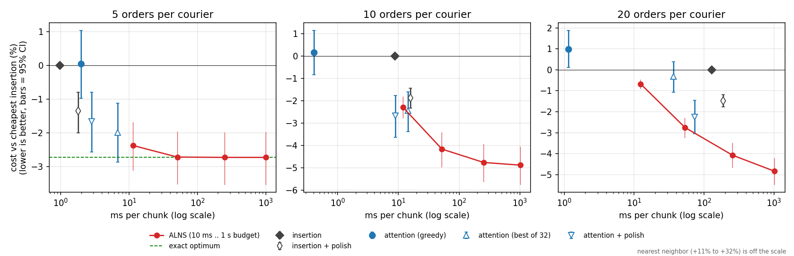

# ALNS for the Meal Delivery Routing Problem (Jhan Modi)

Adaptive Large Neighborhood Search (Ropke and Pisinger, 2006), run online on the Grubhub MDRP instances and,
for a like-for-like comparison with the attention model, on the same per-courier chunks.

## 1. Method

**Requests.** Each order is a request: a pickup at its restaurant (not before the ready time, finished
before the courier's off-time) followed later, on the same route, by a delivery. Once an order is picked
up it becomes a delivery-only request that must stay with its courier but can still be re-sequenced.

**Objective.** The team's weighted cost from `baselines.py`, unchanged: 1.0 × click-to-door + 1.0 ×
lateness beyond the 40-minute target + 0.5 × food waiting (ready but not yet collected) + 0.2 × courier
travel minutes. Orders with no feasible courier cost a large penalty, so the search serves every order it can.

**Operators** (as in Ropke and Pisinger):

| Destroy | Repair |
|---|---|
| random removal | greedy (cheapest insertion first) |
| worst removal: largest cost saving, randomized with p = 3 | regret-2 |
| related (Shaw) removal: close pickup and delivery locations and visit times, p = 6 | regret-3 |

Each iteration removes q requests, q uniform in [1, max(4, ξ·#requests)], capped at 30. Operators are
picked by roulette wheel. Weights are updated every 50 iterations with scores 33 (new best), 9 (better
than current) and 13 (accepted worse), reaction factor 0.1. Acceptance is simulated annealing: the start
temperature makes a 5% worse solution pass with probability 0.5, and the temperature decays geometrically
to cool × T0 over the time budget. On a single-courier chunk there is only one route, so regret-k compares
the k best distinct pickup positions instead of the k best routes.

**Online use (full instances).** `online_alns.py` simulates the service day.

1. Each order is revealed at its placement time and inserted at once by cheapest insertion. This is the
   greedy baseline's rule. An order may only go to the 20 couriers who can reach its restaurant
   earliest, a standard granular restriction that keeps every epoch fast.
2. Every 5 minutes ALNS re-optimizes all not-yet-committed stops for up to 5 s, warm-started from the
   current plan. Operator weights carry over between epochs. A run stops early after 2,000 iterations
   without a new best.
3. A stop is committed once its courier departs for it. The plan's first stops are frozen, picked-up orders
   stay on their courier, and the courier's start state moves forward.
4. Lazy departure: a courier leaves for a pickup only as late as still reaches the restaurant by the ready
   time. The planned cost is identical, but the stop stays open to re-optimization for longer.

The proposal's literal design, where new orders wait for the next epoch ("batch" mode), is kept as an
ablation.

**Exact, fast insertion.** Every insertion of a request into a route is scored exactly, all (pickup slot,
delivery slot) pairs at once. Inserting stops can only delay later stops: travel times are rounded-up
Euclidean times, so the triangle inequality holds. A delay passes unchanged through every stop except a
pickup where the courier would wait for the food, which absorbs up to its waiting slack. So the cost of a
route suffix under any delay comes from a small table built once per route (`RouteEval` in `alns.py`).
Long routes use numpy; short routes, the usual case in full instances, use a pruned pure-Python
enumeration. `test_alns.py` checks both against brute-force simulation of every insertion, with and
without binding shift ends.

## 2. Making the comparisons fair

The feedback raised one main concern: the attention model runs on per-courier batches while ALNS runs on
full instances. Here is how each comparison is set up so that the methods face the same problem.

1. **Same problems at the chunk level.** ALNS solves exactly the 100 real held-out chunks per size
   (5/10/20 orders) that the attention model is tested on. It is scored by the same function
   (`chunk_env.route_cost`) and timed in the same script on the same machine as nearest neighbor,
   insertion, attention and polish (`eval_alns_chunks.py`). ALNS runs at wall-clock budgets of 10 ms to
   1 s per chunk, a range that brackets the attention model's runtimes, so results can be read at matched
   time.
2. **Same simulator at the full-instance level.** With the search switched off, the online simulator
   reproduces the greedy-insertion baseline exactly: courier routes and order times are byte-identical
   (checked in `test_alns.py`). So every full-instance difference between ALNS and greedy comes from the
   ALNS search itself. The rolling-greedy ablation (same simulator and lazy departures, no search) separates
   the simulator's mechanics from the search.
3. **Same evaluator.** Every full-instance solution is written in the official format and checked by
   the official Grubhub evaluator (`mdrplib/MDRP_code`). All metrics come from one function that reads the
   solution files, whichever method wrote them (`full_eval.py`).
4. **No tuning on test data.** All ALNS settings (online mode, removal fraction, cooling, time budget)
   were chosen on the 3 calibration seeds only: chunks cut from them, and their 9 full instances. The
   7 test seeds were used only for the final runs.
5. **Variance.** ALNS is randomized, so it runs with 3 seeds. Results report the mean and the spread
   across run seeds, plus the spread across instance seeds rather than across chunks, as the proposal asks.

## 3. Per-courier chunks: ALNS vs the attention model (same problems, same scorer, same machine)

100 real held-out chunks per size from the 7 test seeds. Cost per order (lower is better), gap to
cheapest insertion with a paired-bootstrap 95% CI over chunks, and the mean ± std of that gap across
instance seeds. ALNS numbers are the mean of 3 run seeds. Settings: removal fraction 0.25, cooling 0.1,
both tuned on calibration-seed chunks. Everything was timed in one run of `eval_alns_chunks.py`, with ALNS
in 8 parallel single-threaded workers and attention batched over the 100 chunks (amortized per chunk).

**5 orders per courier** (exact optimum 98.80, from branch and bound)

| Method | Cost/order | vs insertion [95% CI] | Across seeds | vs optimum | Chunks at optimum | ms/chunk |
|---|---|---|---|---|---|---|
| Nearest neighbor | 133.58 | +31.52% [+24.8, +38.9] | +31.05 ± 11.40 | +35.21% | 1/100 | 0.0 |
| Insertion | 101.57 | 0 | 0 | +2.80% | 38/100 | 1.0 |
| Attention (greedy) | 101.62 | +0.05% [−1.0, +1.0] | +0.07 ± 0.90 | +2.86% | 27/100 | 2.0 |
| Attention (best of 32) | 99.55 | −1.99% [−2.9, −1.1] | −1.97 ± 0.71 | +0.76% | 63/100 | 6.8 |
| Attention + polish | 99.87 | −1.67% [−2.6, −0.8] | −1.64 ± 0.79 | +1.09% | 67/100 | 2.8 |
| Insertion + polish | 100.19 | −1.35% [−2.0, −0.8] | −1.33 ± 0.65 | +1.42% | 64/100 | 1.8 |
| ALNS (10 ms) | 99.15 | −2.38% [−3.1, −1.7] | −2.36 ± 0.69 | +0.36% | 74/100 | 11.5 |
| **ALNS (50 ms)** | **98.81** | −2.72% [−3.5, −2.0] | −2.71 ± 0.82 | **+0.01%** | 97/100 | 50.9 |
| ALNS (250 ms) | 98.80 | −2.73% [−3.5, −2.0] | −2.72 ± 0.82 | +0.00% | 99/100 | 250.9 |
| ALNS (1 s) | 98.80 | −2.73% [−3.5, −2.0] | −2.72 ± 0.82 | 0.00% | 100/100 | 1001.1 |

A chunk counts as "at optimum" when the ALNS cost averaged over its 3 run seeds equals the exact optimum.

**10 orders per courier**

| Method | Cost/order | vs insertion [95% CI] | Across seeds | ms/chunk |
|---|---|---|---|---|
| Nearest neighbor | 225.85 | +17.74% [+14.5, +21.2] | +17.75 ± 3.99 | 0.1 |
| Insertion | 191.82 | 0 | 0 | 8.8 |
| Attention (greedy) | 192.12 | +0.16% [−0.8, +1.1] | +0.18 ± 1.18 | 0.4 |
| Attention (best of 32) | 187.13 | −2.44% [−3.4, −1.6] | −2.41 ± 1.00 | 14.3 |
| Attention + polish | 186.70 | −2.67% [−3.6, −1.8] | −2.63 ± 1.36 | 9.0 |
| Insertion + polish | 188.22 | −1.87% [−2.3, −1.4] | −1.89 ± 0.65 | 15.7 |
| ALNS (10 ms) | 187.42 | −2.29% [−2.8, −1.8] | −2.28 ± 0.52 | 11.9 |
| ALNS (50 ms) | 183.83 | −4.16% [−5.0, −3.4] | −4.14 ± 1.10 | 52.1 |
| ALNS (250 ms) | 182.69 | −4.76% [−5.6, −4.0] | −4.72 ± 1.32 | 254.4 |
| **ALNS (1 s)** | **182.46** | **−4.88% [−5.7, −4.1]** | −4.84 ± 1.34 | 1015.2 |

**20 orders per courier**

| Method | Cost/order | vs insertion [95% CI] | Across seeds | ms/chunk |
|---|---|---|---|---|
| Nearest neighbor | 413.56 | +11.26% [+9.1, +13.5] | +11.31 ± 2.17 | 0.2 |
| Insertion | 371.71 | 0 | 0 | 128.4 |
| Attention (greedy) | 375.40 | +0.99% [+0.1, +1.9] | +1.02 ± 0.73 | 1.1 |
| Attention (best of 32) | 370.52 | −0.32% [−1.1, +0.4] | −0.31 ± 0.47 | 36.5 |
| Attention + polish | 363.33 | −2.25% [−3.0, −1.5] | −2.24 ± 0.57 | 73.8 |
| Insertion + polish | 366.26 | −1.47% [−1.8, −1.2] | −1.46 ± 0.30 | 189.2 |
| ALNS (10 ms) | 369.20 | −0.67% [−0.9, −0.5] | −0.68 ± 0.14 | 12.4 |
| ALNS (50 ms) | 361.49 | −2.75% [−3.2, −2.3] | −2.75 ± 0.21 | 53.5 |
| ALNS (250 ms) | 356.57 | −4.07% [−4.7, −3.5] | −4.07 ± 0.38 | 256.9 |
| **ALNS (1 s)** | **353.74** | **−4.83% [−5.5, −4.2]** | −4.84 ± 0.42 | 1022.5 |

The ALNS spread across run seeds is small: the std of the mean cost/order across the 3 seeds is at most
0.55, except 1.35 at n=20 with 10 ms, against differences of several units between methods.

**Reading at matched time.**
- At about 10 ms per chunk or less, the attention model is as good or better. Greedy decoding takes
  0.4 to 2 ms. At n=10, attention + polish (9 ms, −2.67%) matches ALNS at 12 ms (−2.29%; the CIs
  overlap). At n=20, ALNS at 10 ms only gets through about one iteration after building its start.
- From about 50 ms per chunk on, ALNS is best at every size. On five-order chunks it is optimal on
  97/100 at 50 ms and on all 100 at 1 s. With 1 s it is 4.8% below insertion at 10 and 20 orders,
  against 2.3 to 2.7% for the best attention variant.
- This matches the proposal's expectation: the learned model is fastest and beats nearest neighbor;
  ALNS gives the best quality when it can spend more time.

## 4. Full instances: online ALNS vs the baselines (10 held-out test instances)

The 10 instances are test-seed instances evenly spaced by order count (483 to 3,213 orders). They cover
all 7 test seeds and every variant type (o100/o50/r50, s1/s2, t100/t75, p100/p125). Every method sees
orders only from their placement time on. **All 70 solutions were accepted as FEASIBLE by the official
Grubhub evaluator.** Metrics come from the solution files (`full_eval.py`), per delivered order;
ALNS uses 5 s per 5-minute epoch with 3 run seeds.

| Method | Gap vs greedy [95% CI over instances] | Across instance seeds (7) | Wins | Unserved | Click-to-door (min) | Late % (> 40 min) | Food wait (min) | Travel (min) | Gap to bound* | Run time |
|---|---|---|---|---|---|---|---|---|---|---|
| Nearest neighbor | +28.96% [+12.9, +46.6] | +29.53 ± 28.74 | 0/10 | 161 | 45.80 | 51.8 | 10.75 | 18,682 | 42.3% | <1 s |
| Greedy insertion | 0 | 0 | — | 3 | 39.12 | 38.6 | 3.04 | 17,052 | 13.9% | 6 s |
| No search (same simulator, budget 0) | +3.43% [+1.75, +5.32] | +2.94 ± 2.17 | 1/10 | 3 | 39.90 | 41.2 | 3.39 | 16,869 | 17.8% | 1 s |
| ALNS, batch (proposal's design) | −5.38% [−8.08, −2.81] | −5.23 ± 4.41 | 10/10 | 3 | 37.58 | 34.2 | 1.75 | 16,561 | 8.6% | 3.9 min |
| **ALNS, event + lazy (chosen)** | **−5.85% [−8.46, −3.44]** | **−5.67 ± 4.24** | **10/10** | **3** | **37.44** | **34.0** | **1.63** | **16,633** | **8.1%** | 3.9 min |

\* Gap to a lower bound on the delivery-time + lateness part of the cost. The bound assumes a courier is
waiting at the restaurant the moment the food is ready and drives straight to the customer. The 3
unserved orders are the same for every method except nearest neighbor: no courier can reach them before
its shift ends.

Per instance (objective per delivered order, lower is better):

| Instance | Orders | Couriers | NN | Greedy | ALNS (mean ± std, 3 seeds) | ALNS vs greedy | Batch ALNS vs greedy | ALNS run time |
|---|---|---|---|---|---|---|---|---|
| 3o50t75s1p100 | 483 | 117 | 37.28 | 36.40 | 35.78 ± 0.03 | −1.70% | −0.99% | 0.7 min |
| 4o50t100s2p125 | 592 | 91 | 84.04 (15 unserved) | 55.39 | 50.75 ± 0.19 | −8.39% | −8.04% | 2.0 min |
| 6r50t100s1p125 | 831 | 127 | 86.44 (24 unserved) | 59.51 | 53.01 ± 0.40 | −10.92% | −10.57% | 2.8 min |
| 9r50t100s2p125 | 880 | 226 | 48.97 | 47.64 | 47.35 ± 0.12 | −0.59% | −0.01% | 1.4 min |
| 4o100t100s1p125 | 1185 | 182 | 83.11 (90 unserved) | 55.83 | 51.00 ± 0.09 | −8.66% | −8.67% | 4.6 min |
| 8r50t75s1p100 | 1226 | 238 | 37.89 | 36.80 | 35.94 ± 0.04 | −2.35% | −1.49% | 2.6 min |
| 5o50t100s1p100 | 1362 | 173 | 110.47 (29 unserved) | 59.43 | 51.40 ± 0.16 | −13.51% | −13.32% | 5.6 min |
| 6o100t75s1p100 | 1671 | 234 | 44.92 | 39.28 | 37.46 ± 0.13 | −4.65% | −3.75% | 4.1 min |
| 8o100t100s1p100 | 2444 | 457 | 41.83 | 40.77 | 39.66 ± 0.09 | −2.71% | −1.97% | 5.1 min |
| 7o100t100s2p125 | 3213 | 400 | 65.96 | 49.67 | 47.17 ± 0.06 | −5.04% | −5.04% | 10.0 min |

**What this shows.**
- ALNS beats greedy insertion on all 10 held-out instances: −5.85% on average (95% CI −8.5% to −3.4%).
  It cuts late deliveries from 38.6% to 34.0% of orders, mean click-to-door by 1.7 minutes and food
  waiting by almost half. It also travels slightly less. It roughly halves the gap to the lower bound
  (13.9% → 8.1%).
- The gain comes from the search. The same simulator without search is 3.4% *worse* than greedy. It
  differs from greedy only in its mechanics: it considers the 20 nearest couriers per order and departs
  lazily. So none of the improvement is a side effect of the simulator.
- Gains are largest where greedy is furthest from the bound, 15 to 35% above it (4o50, 6r50, 4o100,
  5o50): ALNS is 8 to 14% better there and halves that gap. These are also among the instances with the
  fewest courier-hours per order (0.41 to 0.47). Gains are smallest where greedy is already within about
  5% of the bound (3o50, 9r50, 8r50: −0.6% to −2.4%).
- Run-to-run variation is small: the std over 3 seeds is at most 0.40 cost per order, against differences
  of 0.3 to 8 between ALNS and greedy.
- Runtime: a whole service day (about 13 to 16 hours of orders, 166 epochs on average) is simulated in 0.7
  to 10 minutes. That includes up to 5 s of ALNS per 5 real minutes, so the method could run in real time.
- Inserting orders on arrival and re-optimizing every 5 minutes is slightly better than the proposal's
  batch design (−5.85% vs −5.38%), matching what was found on the calibration instances.

## 6. Limitations and notes for the team

- **Timing.** ALNS is pure Python (with numpy for long routes), run in 8 parallel single-threaded
  workers. Attention timings are batched in torch on the same machine. A compiled ALNS would move its
  curve left; the ordering at 50 ms and above would not change.
- **The attention model on full instances.** The proposal applies the attention model to full instances
  through a nearest-available-courier rule. To keep that comparison fair it should run inside the same
  simulator (`online_alns.py`): replace the ALNS call in `OnlineALNS.run` with a per-courier router and
  score it with `full_eval.py`. The rolling-horizon OR-Tools method can plug in the same way. Then all
  three methods share the information model, freezing rule and evaluator.
- **Objective.** The objective is the team's weighted cost. The official evaluator checks feasibility
  and also reports Grubhub's own metrics (courier pay, orders per hour), written to each solution folder
  as `solution_performance.txt`. Those were not optimized.

## 5. Tuning (calibration seeds 0 to 2 only)

All full-instance tuning used the 9 calibration instances (242 to 707 orders), one run each. Gaps are per
instance, relative to greedy insertion (negative is better), averaged over instances.

**Online design** (2 s per epoch, removal fraction 0.25, cooling 0.01; run before cooling was tuned):

| Variant | Mean gap [95% CI over instances] | Wins vs greedy |
|---|---|---|
| no search, event insertion + lazy departures | +0.54% [−0.19, +1.48] | 3/9 |
| no search, batch insertion every 5 min | +0.60% [−1.01, +1.76] | 1/9 |
| ALNS, batch (proposal's design), no lazy departures | −2.33% [−5.37, −0.55] | 8/9 |
| ALNS, batch + lazy departures | −3.06% [−6.20, −1.04] | 9/9 |
| ALNS, event insertion, no lazy departures | −3.00% [−6.36, −0.99] | 9/9 |
| **ALNS, event insertion + lazy departures (chosen)** | **−3.59% [−6.75, −1.55]** | **9/9** |

The gain comes from the search, not from the simulator: without ALNS the same simulator is no better than
greedy. Inserting orders as they arrive (as the greedy baseline does) and re-optimizing every 5 minutes
beats making new orders wait for the next epoch.

**Removal fraction ξ × cooling** (2 s per epoch): every one of the 9 settings beats greedy on 9/9
instances, with mean gaps from −3.36% to −3.79%, so ALNS is insensitive to these two parameters. ξ = 0.25
with cooling 0.1 has the best mean rank across instances (3.78 of 9). The highest mean (ξ = 0.1) is
driven by one congested instance, `1o50t100s1p125`. Independently, tuning on calibration-seed chunks
(`tune_alns_chunks.py`, 250 ms, 50 chunks per size) also picked ξ = 0.25 and cooling 0.1. That setting is
used everywhere.

**Time budget per epoch** (ξ = 0.25, cooling 0.1):

| Budget | 0.5 s | 1 s | 2 s | 5 s |
|---|---|---|---|---|
| Mean gap vs greedy | −3.35% | −3.74% | −3.57% | −3.70% |
| Mean rank (of 4) | 3.11 | 1.78 | 2.67 | 2.44 |

Quality plateaus from 1 s on. Calibration epochs are small, so the early stop (2,000 iterations without a
new best) usually ends them before the budget runs out. Test instances have up to 3,213 orders, and their
epochs hold 3 to 4 times more open requests, so the proposal's 5 s is kept for the test runs. 5 s of
search every 5 minutes is under 2% of real time.
