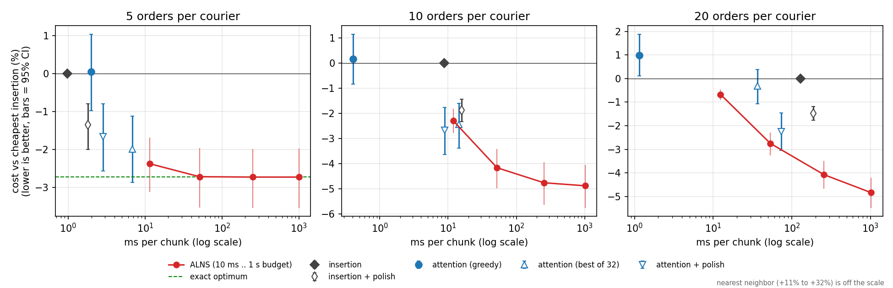

# Meal Delivery Routing: Attention Model vs. Classical Baselines

Course project (team of 3). This repo contains my part: a learned pickup-and-delivery router
(Kool et al., 2019, adapted) and the shared benchmark pipeline, evaluated on the Grubhub
Meal Delivery Routing Problem instances. The ALNS method (Jhan Modi) is also in this repo:
see [ALNS (Jhan Modi)](#alns-jhan-modi) below and [ALNS_REPORT.md](ALNS_REPORT.md). The OR-Tools
rolling-horizon method is Vaibhavi Bagri's.

## Results (100 real held-out chunks per size, 7 unseen seeds)

Cost per order, lower is better.

| Orders per courier | Nearest-neighbor | Insertion | Attention (greedy) |
|---|---|---|---|
| 5  | 133.6 | 101.6 | 101.6 |
| 10 | 225.9 | 191.8 | 192.1 |
| 20 | 413.6 | 371.7 | 375.4 |

The attention model is within 1% of cheapest insertion and 9-24% better than nearest-neighbor,
3.4% above the exact optimum at 5 orders, and about 4x lower latency at 20 orders
(43 vs. 186 ms). Single training run; spread across seeds not yet reported. Work in progress.

## ALNS (Jhan Modi)

Adaptive Large Neighborhood Search (Ropke and Pisinger, 2006): random, worst and related removal; greedy,
regret-2 and regret-3 insertion; adaptive operator weights; simulated-annealing acceptance. It runs online
on full instances: orders are inserted as they arrive, and every 5 minutes ALNS re-optimizes all
uncommitted stops for 5 s, warm-started from the current plan. Full method, fairness checks, tuning and
all tables are in [ALNS_REPORT.md](ALNS_REPORT.md).

**Fair comparison with the attention model.** ALNS is also run on the same 100 held-out chunks per size,
scored by the same `chunk_env.route_cost` and timed in the same run on the same machine. Gaps are
relative to cheapest insertion (lower is better), with ms per chunk in parentheses:

| Orders per courier | Attention (best variant) | ALNS 10 ms | ALNS 50 ms | ALNS 1 s |
|---|---|---|---|---|
| 5  | −1.99% (best of 32, 7 ms) | −2.38% | −2.72% (+0.01% vs optimum) | −2.73% (optimal on 100/100) |
| 10 | −2.67% (+ polish, 9 ms) | −2.29% | −4.16% | −4.88% |
| 20 | −2.25% (+ polish, 74 ms) | −0.67% | −2.75% | −4.83% |

Attention is the fastest (greedy decoding takes 0.4 to 2 ms) and is as good or better up to about 10 ms
per chunk. From about 50 ms on, ALNS gives the best routes at every size.



**Full instances (10 held-out test instances, 483 to 3,213 orders, all 7 test seeds).** Every solution is
accepted as FEASIBLE by the official Grubhub evaluator. Gap is per instance vs greedy insertion
(lower is better); ALNS uses 3 run seeds:

| Method | Gap vs greedy [95% CI] | Wins | Click-to-door | Late % | Food wait | Travel min | Run time |
|---|---|---|---|---|---|---|---|
| Nearest neighbor | +28.96% [+12.9, +46.6] | 0/10 | 45.80 | 51.8 | 10.75 | 18,682 | <1 s |
| Greedy insertion | 0 | — | 39.12 | 38.6 | 3.04 | 17,052 | 6 s |
| Same simulator, no search | +3.43% [+1.75, +5.32] | 1/10 | 39.90 | 41.2 | 3.39 | 16,869 | 1 s |
| **ALNS (5 s every 5 min)** | **−5.85% [−8.46, −3.44]** | **10/10** | **37.44** | **34.0** | **1.63** | **16,633** | 3.9 min |

With the search switched off, the simulator reproduces the greedy baseline exactly (`test_alns.py`), so
the gain is the search's own. All ALNS settings were tuned on the 3 calibration seeds only.

## Setup

```bash
python -m venv .venv
.venv\Scripts\activate
pip install -r requirements.txt
git clone https://github.com/grubhub/mdrplib.git
```

## Run

```bash
python baselines.py mdrplib/public_instances/0o100t100s1p100 greedy solutions/0o100t100s1p100/greedy
python mdrp_chunks.py          # selects 30 instances, builds test chunks and the synthetic generator
python chunk_env.py            # nearest-neighbor, insertion, exact optimum on the chunks
python train_attention.py --steps 3000
python eval_attention.py

# ALNS (Jhan Modi)
python test_alns.py                       # insertion maths vs brute force; simulator == greedy baseline
python tune_alns_chunks.py                # removal fraction / cooling on calibration-seed chunks
python eval_alns_chunks.py                # chunk benchmark: ALNS vs attention vs baselines, same machine
python plot_alns.py                       # figures/chunks_quality_time.png
python online_alns.py mdrplib/public_instances/3o50t75s1p100 solutions/3o50t75s1p100/alns --budget 5
python full_eval.py mdrplib/public_instances/3o50t75s1p100 solutions/3o50t75s1p100/alns
python run_full.py --set tune --methods greedy alns:budget=2 --tag tune         # calibration instances
python run_full.py --set test --methods nn greedy alns:budget=0 alns:budget=5 --seeds 0 1 2 --tag test
python summarize_full.py test
```

## Files

- `mdrp_data.py`: instance loader
- `baselines.py`: online nearest-neighbor and greedy insertion, plus the official solution writer
- `mdrp_chunks.py`: instance split (3 calibration / 7 test seeds), test chunks, synthetic generator
- `chunk_env.py`: single-courier cost function and chunk baselines
- `attention_model.py`, `train_attention.py`, `eval_attention.py`: the model
- `alns.py`: ALNS engine (operators, adaptive weights, annealing, exact vectorized insertion) and the chunk solver
- `online_alns.py`: online rolling-horizon ALNS on full instances, writes the official solution format
- `full_eval.py`: official evaluator wrapper plus one metric function for every method's solution files
- `run_full.py`, `summarize_full.py`: parallel full-instance runs and their summary (gaps, CIs, seed spread)
- `eval_alns_chunks.py`, `tune_alns_chunks.py`, `plot_alns.py`, `test_alns.py`: chunk benchmark, tuning, figure, tests
- `results_alns_chunks.json`, `results_full_*.jsonl`, `summary_full_*.json`: raw and summarized results

Data: Grubhub MDRP instance library (github.com/grubhub/mdrplib), not included here.